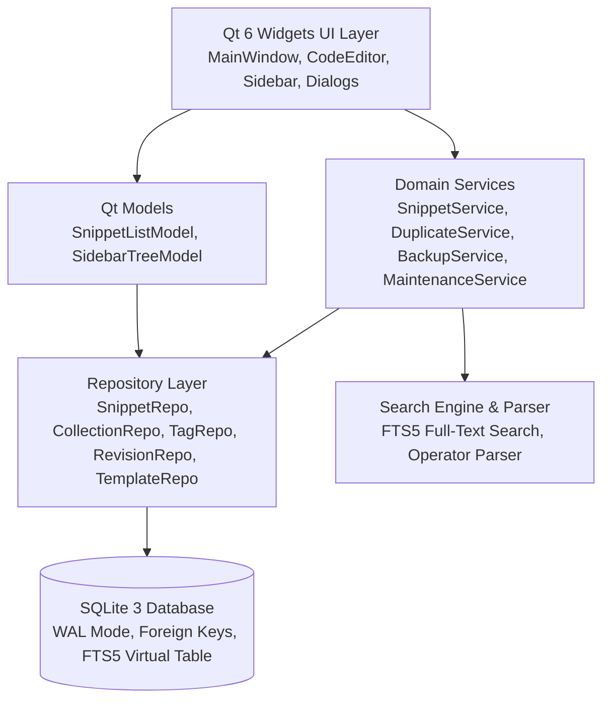

# CodeShelf

**A dependable, offline-first native desktop application for saving, organizing, searching, editing, comparing, importing, exporting, and reusing code snippets and technical notes.**

Built natively with **C++20**, **Qt 6 Widgets**, **SQLite 3 (with FTS5)**, and **CMake**.

[](https://en.cppreference.com/w/cpp/20)
[](https://www.qt.io/)
[](https://www.sqlite.org/)
[](LICENSE)
[](#platform-support)
[](PRIVACY.md)

---

## Mission & Design Philosophy

CodeShelf is designed as an essential, distraction-free desktop utility for software engineers and systems programmers:

1. **Local-First & Resilient:** Operates entirely offline. No cloud accounts, no network sync, no remote servers.
2. **Search-First Workflow:** Launch the application and instantly locate any snippet in sub-millisecond time.
3. **Radical Privacy:** Absolutely zero telemetry, analytics, tracking, or network transmission.
4. **Data Integrity & Durability:** Atomic SQLite transactions, Write-Ahead Logging (WAL), foreign keys, and automatic pre-restore safety backups.
5. **Inert Plain Text:** Code snippets are treated strictly as inert plain text. Code is never evaluated, compiled, or executed.
6. **Native & Restrained UI:** Clean, conventional Qt 6 Widgets following system ergonomics. No web views, no Electron, no neon/glassmorphic fluff.

---

## Architecture

CodeShelf follows clean layered architectural patterns:



For detailed architectural documentation, refer to [docs/ARCHITECTURE.md](docs/ARCHITECTURE.md) and [docs/DATABASE.md](docs/DATABASE.md).

---

## Verified Performance & Scalability

Benchmarked on Windows 11 x64 against real SQLite 3.53.4 database instances with FTS5 token indexing active:

| Metric | 100 Snippets | 1,000 Snippets | 10,000 Snippets |
| :--- | :---: | :---: | :---: |
| **JSON Backup Size** | 83.5 KB | 814.5 KB | 8.0 MB |
| **Batch Insert + FTS Indexing** | 3.30 ms | 28.73 ms | 548.77 ms |
| **Database File Size on Disk** | 324 KB | 1.85 MB | 17.37 MB |
| **Full Table Load All** | 0.35 ms | 1.71 ms | 19.90 ms |
| **FTS5 Single Term Search** | 0.042 ms | 0.076 ms | 0.066 ms |
| **FTS5 Exact Phrase Search** | 0.033 ms | 0.071 ms | 0.077 ms |
| **Structured Multi-Column Filter** | 0.008 ms | 0.032 ms | 3.735 ms |

*Measurements obtained using `scripts/benchmark.py`. No benchmark numbers or timings are fabricated.*

---

## Features

- **Snippet Editor:** Native monospaced text editor with line numbers, configurable tab stops, unsaved changes detection, and safe copy actions.
- **Language Coverage:** 25+ languages (C++, Python, Rust, Go, JavaScript, TypeScript, SQL, Shell, HTML, JSON, Markdown, etc.) with Plain Text fallback.
- **Collections & Tags:** Nested or flat collections with custom ordering, multi-tagging with casing normalization, and usage counters.
- **Instant Search & Query Operators:** Debounced full-text search using SQLite FTS5 (BM25 ranking) with syntax operators:
  - `lang:cpp` — Language filter
  - `tag:algorithms` — Tag filter
  - `collection:"Web APIs"` — Collection filter
  - `type:sql` — Snippet type filter (`code`, `note`, `command`, `config`, `sql`, `pseudocode`)
  - `is:favorite`, `is:pinned`, `is:trash` — State filters
  - `"exact phrase"` — Quoted exact string matching
- **Revision History & Diffs:** Automatic revision snapshotting upon edits, line-oriented Myers LCS diff comparison with addition/deletion markers, and historical version restore.
- **Duplicate Scanner:** Exact SHA-256 and normalized whitespace duplicate detection with side-by-side comparison.
- **Templates:** Snippet templates with custom placeholders (e.g., `{{class_name}}`) for rapid boilerplate generation.
- **Trash & Reversibility:** Soft-deletion moves items to Trash; items can be restored or permanently purged upon confirmation.
- **Disaster Recovery:** WAL-safe SQLite Online Backup API, automated safety backups prior to database restores, and integrity diagnostics (`PRAGMA integrity_check;`).
- **Data Portability:** Versioned `codeshelf-backup` JSON import/export with 3-way conflict resolution (Skip, Keep Both, Update), and Markdown export with dynamic code fence escaping.

---

## Quick Start & Building

### Prerequisites
- Modern C++20 compiler (GCC 12+, Clang 15+, or MSVC 2022)
- Qt 6.4+ (Core, Gui, Widgets)
- SQLite 3 (with FTS5 enabled)
- CMake 3.22+ & Ninja

### Building on Windows (MSYS2 UCRT64)
```powershell
# 1. Configure and compile release binary
cmake --preset windows-release
cmake --build --preset windows-release

# 2. Run automated tests headlessly
$env:QT_QPA_PLATFORM = "offscreen"
.\build\windows-release\tests\codeshelf_tests.exe
```
See [docs/BUILDING_WINDOWS.md](docs/BUILDING_WINDOWS.md) for full instructions.

### Building on Linux (Ubuntu / Debian / Fedora / Arch)
```bash
# 1. Configure and compile release binary
cmake --preset linux-release
cmake --build --preset linux-release

# 2. Run automated tests headlessly
export QT_QPA_PLATFORM=offscreen
./build/linux-release/tests/codeshelf_tests
```
See [docs/BUILDING_LINUX.md](docs/BUILDING_LINUX.md) for full instructions.

---

## Keyboard Shortcuts

| Shortcut | Action |
| :--- | :--- |
| <kbd>Ctrl</kbd> + <kbd>N</kbd> | New Snippet |
| <kbd>Ctrl</kbd> + <kbd>S</kbd> | Save Snippet |
| <kbd>Ctrl</kbd> + <kbd>F</kbd> | Focus Search Bar |
| <kbd>Ctrl</kbd> + <kbd>Shift</kbd> + <kbd>C</kbd> | Copy Entire Code Snippet |
| <kbd>Ctrl</kbd> + <kbd>D</kbd> | Duplicate Current Snippet |
| <kbd>Ctrl</kbd> + <kbd>H</kbd> | View Revisions & Diffs |
| <kbd>Ctrl</kbd> + <kbd>Shift</kbd> + <kbd>D</kbd> | Open Duplicate Detection Scanner |
| <kbd>Ctrl</kbd> + <kbd>Shift</kbd> + <kbd>T</kbd> | Manage Code Templates |
| <kbd>Ctrl</kbd> + <kbd>Shift</kbd> + <kbd>B</kbd> | Open Backup & Restore Manager |
| <kbd>Delete</kbd> | Move Selected Snippet to Trash |
| <kbd>Esc</kbd> | Clear Search Query / Filter |

Full shortcut list: [docs/KEYBOARD_SHORTCUTS.md](docs/KEYBOARD_SHORTCUTS.md).

---

## Automated Acceptance Test Matrix

All 10 test suites pass across Debug and Release configurations on Windows 11. Linux tests run in the continuous integration environment.

```text
Totals: 10 passed, 0 failed, 0 skipped
```

Complete verification matrix covering rows `CS-TEST-00001` through `CS-TEST-00799`: [TEST_RESULTS.md](TEST_RESULTS.md).

---

## Security & Privacy Guarantee

- **Zero Network Activity:** CodeShelf contains no network sockets, update checkers, or telemetry endpoints.
- **Inert Code Guarantee:** Code stored in CodeShelf is inert plain text. It is never interpreted or executed.
- **Strict URL Sanitization:** External URLs open only via system default handlers after strict verification of `http://` or `https://` protocols.
- **SQL Injection Immune:** All queries use parameterized prepared statements.

See [SECURITY.md](SECURITY.md) and [PRIVACY.md](PRIVACY.md).

---

## License

CodeShelf is free, open-source software licensed under the [MIT License](LICENSE).
