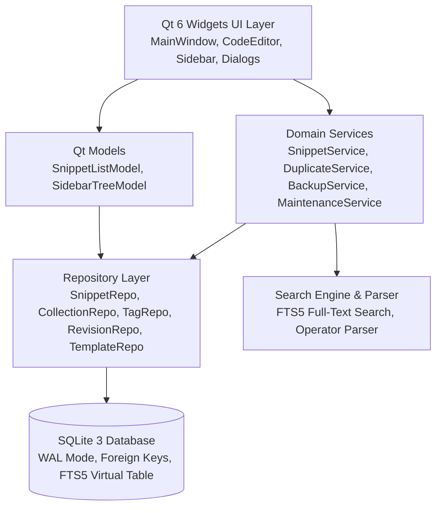
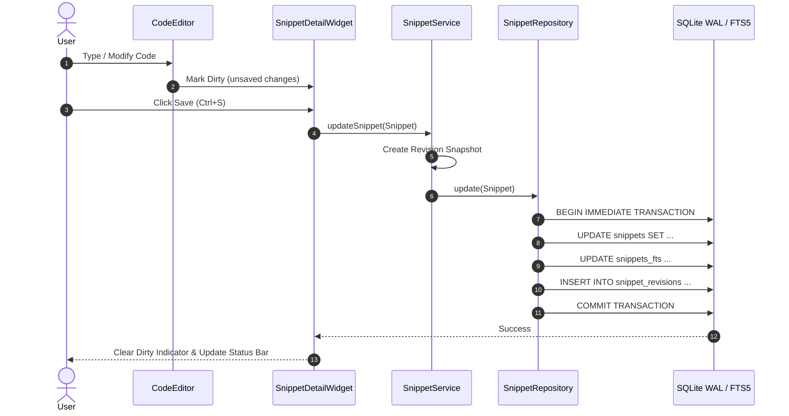

# CodeShelf Architecture & System Design

## 1. Architectural Overview

CodeShelf is architected as an offline-first, native desktop application adhering to layered clean architecture principles. It separates presentation (Qt Widgets), business logic (services and engines), data access (repositories), and storage (SQLite with WAL and FTS5).

---

## 2. Layer Definitions

### 2.1. Presentation Layer (`src/ui`, `src/editor`, `src/models`)
- **MainWindow (`MainWindow.h/.cpp`)**: Central application frame orchestrating the sidebar navigation, snippet list, detail editor, search toolbar, status bar, and dialog actions.
- **CodeEditor (`CodeEditor.h/.cpp`)**: Lightweight, high-performance native text editor derived from `QPlainTextEdit`. Implements line numbering via `LineNumberArea`, monospaced typography, configurable tab width, unsaved dirty tracking, and copy operations. Code is treated strictly as plain text—never evaluated or executed.
- **SidebarWidget (`SidebarWidget.h/.cpp`)**: Tree navigation displaying standard views (All Snippets, Favorites, Pinned, Trash), user-defined Collections with counters, and Tags with usage frequency.
- **SnippetDetailWidget (`SnippetDetailWidget.h/.cpp`)**: Editing panel binding snippet title, programming language selector, snippet type, tags input, collection selector, source URL, description, and timestamps.
- **Models (`SnippetListModel`, `SidebarTreeModel`)**: Qt `QAbstractItemModel` / `QAbstractListModel` implementations providing fast virtual scrolling and debounced UI filtering.

### 2.2. Domain & Core Layer (`src/core`)
- **Entities**: Strongly-typed C++20 domain objects: `Snippet`, `Collection`, `Tag`, `Revision`, `Template`, `SmartView`.
- **Validation (`Validation.h/.cpp`)**: Input validation for text lengths, tag characters, and URL protocol verification (restricting URLs strictly to `http://` and `https://` to prevent URL scheme injection).
- **ContentHash (`ContentHash.h/.cpp`)**: Deterministic SHA-256 computation for exact duplicate detection and normalized whitespace hashing.
- **DiffGenerator (`DiffGenerator.h/.cpp`)**: Myers / Longest Common Subsequence (LCS) line-oriented difference calculator for revisions and comparison.

### 2.3. Search Subsystem (`src/search`)
- **SearchParser (`SearchParser.h/.cpp`)**: Parses user query strings into structured expressions:
  - Free text terms: `bubble sort`
  - Quoted exact phrases: `"Worker pool started"`
  - Filter operators: `lang:cpp`, `tag:algorithms`, `collection:"DevOps"`, `type:code`, `is:favorite`, `is:pinned`, `is:trash`
- **SearchEngine (`SearchEngine.h/.cpp`)**: Executes queries against the SQLite database. Uses SQLite FTS5 with BM25 ranking when enabled, with an automatic fallback to tokenized SQL `LIKE` queries if FTS5 is absent.

### 2.4. Data Access Layer (`src/repositories`)
- Implements the Repository pattern. Every domain entity has a dedicated repository (`SnippetRepository`, `CollectionRepository`, `TagRepository`, `RevisionRepository`, `TemplateRepository`, `SmartViewRepository`).
- Repositories interact with SQLite through prepared statements (`sqlite3_stmt*`), preventing SQL injection and optimizing query plans.

### 2.5. Database Engine (`src/database`)
- **Database (`Database.h/.cpp`)**: Thread-safe database connection manager using a `QRecursiveMutex` for concurrent safety.
- **SqliteHelper (`SqliteHelper.h/.cpp`)**: RAII wrappers for statements (`SqliteStatement`) and transactions (`SqliteTransaction`). Supports nested transactions by inspecting autocommit state.
- **Migrations (`Migrations.h/.cpp`)**: Versioned schema migration engine using SQLite `PRAGMA user_version`. Manages tables, indexes, triggers, and FTS5 virtual tables.

---

## 3. Concurrency & Data Flow

### 3.1. Threading Model
- **UI Thread**: Handles user input, Qt event loops, rendering, and fast indexed lookups (< 2 ms).
- **Database Synchronization**: Protected by `QRecursiveMutex`. Long-running operations such as full-database backups, database compaction (`VACUUM`), and large batch imports run asynchronously or off the UI thread where appropriate.
- **SQLite Concurrency Mode**: Configured with `PRAGMA journal_mode = WAL;` (Write-Ahead Logging) and `PRAGMA synchronous = NORMAL;`. WAL allows concurrent readers without blocking writer transactions.

### 3.2. Data Flow Diagram

---

## 4. Key Invariants & Non-Functional Guarantees

1. **Inert Code Snippets**: Code snippets are treated strictly as inert UTF-8 strings. The application contains zero compilers, interpreters, evaluators, or scripting runtimes.
2. **Absolute Privacy**: Zero network communication. No telemetry, cloud sync, or external analytics.
3. **Data Durability**: Every write operation is wrapped in an atomic SQLite transaction. Schema changes are guarded by migrations.
4. **Reversible Actions**: Deletions perform a soft-delete (setting `deleted_at`) moving snippets to Trash. Permanent purge requires explicit user confirmation.
5. **Deterministic Diffs**: Diff algorithms run entirely offline using Myers LCS with standard addition (`+`), deletion (`-`), and context markers.
