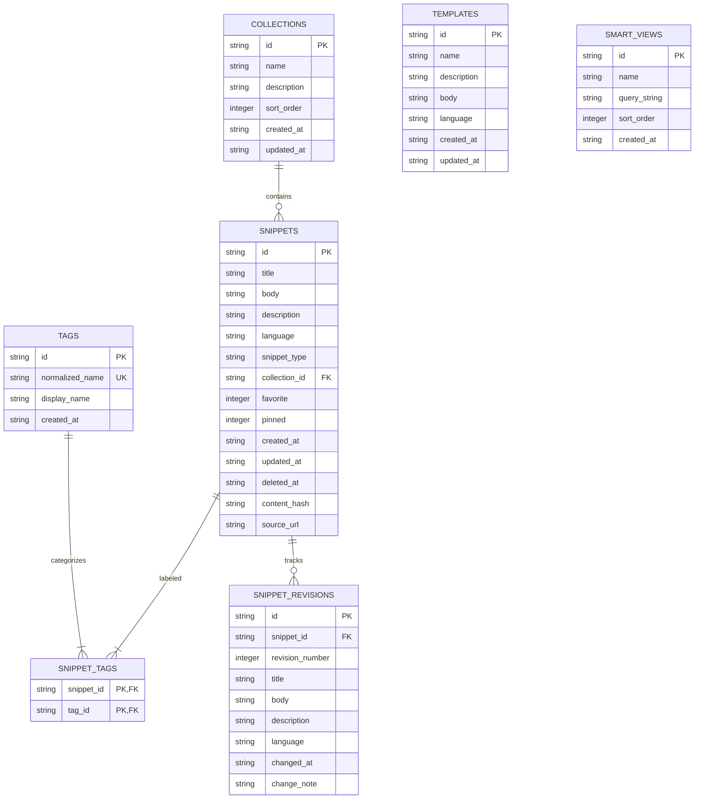

# CodeShelf Database Architecture & Schema Specification

## 1. Overview & SQLite Pragmas

CodeShelf utilizes an embedded **SQLite 3** database with the following core pragma configurations applied upon connection initialization:

```sql
PRAGMA foreign_keys = ON;
PRAGMA journal_mode = WAL;
PRAGMA synchronous = NORMAL;
PRAGMA temp_store = MEMORY;
PRAGMA busy_timeout = 5000;
```

- **Foreign Key Constraints**: Strictly enforced on all relational tables.
- **Write-Ahead Logging (WAL)**: Provides non-blocking concurrent reads during write transactions, preventing UI stutters.
- **Synchronous Normal**: Offers optimal durability in WAL mode while avoiding unnecessary disk flush overhead.
- **Busy Timeout (5000 ms)**: Prevents `SQLITE_BUSY` errors during concurrent transactions.

---

## 2. Entity-Relationship Diagram



---

## 3. Schema DDL Specification (Version 1)

### 3.1. `schema_metadata`
Stores application metadata, key-value configurations, and schema markers.
```sql
CREATE TABLE IF NOT EXISTS schema_metadata (
    key TEXT PRIMARY KEY,
    value TEXT NOT NULL
);
```

### 3.2. `collections`
User-defined snippet groupings.
```sql
CREATE TABLE IF NOT EXISTS collections (
    id TEXT PRIMARY KEY,
    name TEXT NOT NULL,
    description TEXT,
    sort_order INTEGER NOT NULL DEFAULT 0,
    created_at TEXT NOT NULL,
    updated_at TEXT NOT NULL
);
```

### 3.3. `tags`
Tag library with case normalization. `normalized_name` is lowercase and unique.
```sql
CREATE TABLE IF NOT EXISTS tags (
    id TEXT PRIMARY KEY,
    normalized_name TEXT NOT NULL UNIQUE,
    display_name TEXT NOT NULL,
    created_at TEXT NOT NULL
);
```

### 3.4. `snippets`
Primary snippet storage table.
```sql
CREATE TABLE IF NOT EXISTS snippets (
    id TEXT PRIMARY KEY,
    title TEXT NOT NULL,
    body TEXT NOT NULL,
    description TEXT,
    language TEXT NOT NULL,
    snippet_type TEXT NOT NULL,
    collection_id TEXT REFERENCES collections(id) ON DELETE SET NULL,
    favorite INTEGER NOT NULL DEFAULT 0,
    pinned INTEGER NOT NULL DEFAULT 0,
    created_at TEXT NOT NULL,
    updated_at TEXT NOT NULL,
    deleted_at TEXT,
    content_hash TEXT NOT NULL,
    source_url TEXT
);
```

### 3.5. `snippet_tags`
Many-to-many junction table between snippets and tags.
```sql
CREATE TABLE IF NOT EXISTS snippet_tags (
    snippet_id TEXT NOT NULL REFERENCES snippets(id) ON DELETE CASCADE,
    tag_id TEXT NOT NULL REFERENCES tags(id) ON DELETE CASCADE,
    PRIMARY KEY (snippet_id, tag_id)
);
```

### 3.6. `snippet_revisions`
Append-only historical snapshots of snippet edits.
```sql
CREATE TABLE IF NOT EXISTS snippet_revisions (
    id TEXT PRIMARY KEY,
    snippet_id TEXT NOT NULL REFERENCES snippets(id) ON DELETE CASCADE,
    revision_number INTEGER NOT NULL,
    title TEXT NOT NULL,
    body TEXT NOT NULL,
    description TEXT,
    language TEXT NOT NULL,
    changed_at TEXT NOT NULL,
    change_note TEXT
);
```

### 3.7. `templates`
Code templates with token placeholders (e.g., `{{variable_name}}`).
```sql
CREATE TABLE IF NOT EXISTS templates (
    id TEXT PRIMARY KEY,
    name TEXT NOT NULL,
    description TEXT,
    body TEXT NOT NULL,
    language TEXT NOT NULL,
    created_at TEXT NOT NULL,
    updated_at TEXT NOT NULL
);
```

### 3.8. `smart_views`
Saved search queries and filter combinations.
```sql
CREATE TABLE IF NOT EXISTS smart_views (
    id TEXT PRIMARY KEY,
    name TEXT NOT NULL,
    query_string TEXT NOT NULL,
    sort_order INTEGER NOT NULL DEFAULT 0,
    created_at TEXT NOT NULL
);
```

---

## 4. Indexing Strategy

To guarantee sub-millisecond query execution at 10,000+ snippets, the following B-tree indexes are maintained:

```sql
CREATE INDEX IF NOT EXISTS idx_snippets_collection ON snippets(collection_id);
CREATE INDEX IF NOT EXISTS idx_snippets_language ON snippets(language);
CREATE INDEX IF NOT EXISTS idx_snippets_favorite ON snippets(favorite);
CREATE INDEX IF NOT EXISTS idx_snippets_pinned ON snippets(pinned);
CREATE INDEX IF NOT EXISTS idx_snippets_deleted_at ON snippets(deleted_at);
CREATE INDEX IF NOT EXISTS idx_snippets_updated_at ON snippets(updated_at);
CREATE INDEX IF NOT EXISTS idx_snippets_content_hash ON snippets(content_hash);
CREATE INDEX IF NOT EXISTS idx_snippet_tags_tag ON snippet_tags(tag_id);
CREATE INDEX IF NOT EXISTS idx_revisions_snippet ON snippet_revisions(snippet_id, revision_number);
```

---

## 5. Full-Text Search (FTS5)

When SQLite FTS5 module is detected, a shadow virtual table `snippets_fts` is utilized with the Porter stemmer and Unicode 61 tokenizer:

```sql
CREATE VIRTUAL TABLE IF NOT EXISTS snippets_fts USING fts5(
    snippet_id UNINDEXED,
    title,
    description,
    body,
    tags,
    tokenize = 'porter unicode61'
);
```

### FTS Synchronization
When snippets are created, updated, or removed, corresponding rows in `snippets_fts` are synchronized transactionally. In the event of index corruption or manual recovery, the index is completely rebuilt via:

```sql
INSERT INTO snippets_fts(snippets_fts) VALUES('rebuild');
```

---

## 6. Maintenance Operations

The application provides dedicated native dialogs for performing SQLite maintenance routines:
1. **Integrity Check**:
   ```sql
   PRAGMA integrity_check;
   ```
2. **Database Compaction & Defragmentation**:
   ```sql
   PRAGMA wal_checkpoint(TRUNCATE);
   VACUUM;
   ```
3. **WAL-Safe Backup**: Utilizes the SQLite Online Backup API (`sqlite3_backup_init`, `sqlite3_backup_step`, `sqlite3_backup_finish`) to safely copy the active database without corruption.
